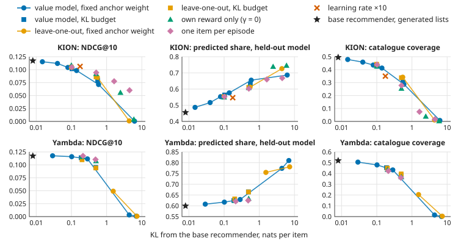
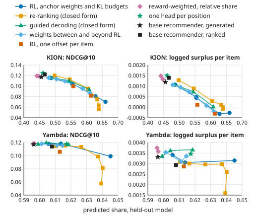

# RecSysMaxxing

What happens when a generative recommender is fine-tuned with reinforcement learning against a learned reward
model: what the fine-tuning changes, what it costs in relevance, and what keeps the recommender relevant. KION, an
online cinema, is the main dataset; Yambda-50M, a music service, repeats the central comparisons.

| | |
|---|---|
| **Report** | [`report/paper_v5.pdf`](report/paper_v5.pdf): 20 pages with the supporting tables, organised around the task's five questions, with a glossary of its terms |
| **Reproduce the main result** | [`kaggle/0_quick_kion.ipynb`](kaggle/0_quick_kion.ipynb): one Kaggle session on any GPU with the internet on, nothing to attach |
| **Every reported number** | [`results/`](results/): the CSV reports and the configuration of every session; `report/tables.py` and `report/figures.py` typeset the paper's tables and figures from them |

## In short

- **Setup.** A GPT-2 recommender over item IDs generates lists of ten, item by item. A second GPT-2, the *reward
  model*, predicts the share of an item the user will consume, before the user consumes it. PPO raises that predicted
  share, and a KL penalty towards the pretrained recommender, the *anchor*, is the only term that asks for relevance.
  The data are split by time: the last week is the test period, the week before it validation. Every gain is
  checked by instruments the optimised model cannot influence: a reward model trained on other users, the responses
  the log recorded, and the same lists scored for another user. The central comparisons have three seeds.
- **Q1, behaviour.** The predicted reward rises, by 24% on KION, and the held-out reward model agrees. What RL learns,
  though, is one re-weighting of the catalogue, from long series towards short films that everybody finishes. Held to
  one score offset per item, RL reaches about 90% of its gain, and the same lists earn the same for other users.
  Measured against what is usual for each title, users took to the recommended titles less, not more.
- **Q2, relevance.** Relevance is traded along a frontier. At the anchor weight chosen on validation requests, KION's
  NDCG@10 falls by 1.8% for an 8% higher predicted share; at the main run it falls by 11.5% for 24%. Users with short
  histories lose most, and without the anchor every user receives the same list. On Yambda relevance holds.
- **Q3, long-term goals.** Return, likes and adoption can be predicted and rewarded, but they move by a few percent.
  The largest predicted gain, the return after the list, lies beyond any return rate in the log. Offline we can test
  whether a signal is predictable, whether it differs between candidates, and what it costs; whether users return
  needs the online test designed in the paper.
- **Q4, several steps ahead.** A generated list gains after a hit and loses after a miss. Simulated responses bias the
  predicted reward of later positions. Predicting each position from the real history removes the loss after a miss:
  6.3% more NDCG@10 than generation on KION.
- **Q5, the trade-off.** RL settings (anchor, estimator, credit along the list, capacity) only choose a point on the
  frontier. Re-ranking or decoding by the closed-form optimum of the anchored objective reaches it without training.
  The frontier moved only when the reward came from the log: reward-weighted fine-tuning on the logged share
  relative to the item's usual, with no reward model. A control written down before its run separates its weights
  from the extra epoch of training it adds: over the same epoch with every weight equal to one, the weights raise a
  length-neutral logged response by 21% and personalisation by 19% on generated lists (17% and 15% on ranked lists),
  with NDCG@10 up by 1.3% (0.7%), in every seed. A third of the 1.9% NDCG@10 gain over the base recommender is the
  epoch's.
- **Limits.** Everything is offline. Yambda's base recommender is below replaying the user's own history, so relevance
  there is measured against a weak start. The models are small (4 layers of width 256).



Every fine-tuning run of the default reward against the KL distance it ended at from the base recommender. Runs that
differ in the advantage estimator, in how the constraint is set and in how credit is assigned lie on one curve.



RL, its interpolated and extrapolated weights, re-ranking and guided decoding share one frontier. Reward-weighted
fine-tuning on the relative share and one head per position leave it towards relevance and a higher logged surplus.

| KION, test requests, seed 0 | NDCG@10 | Predicted share (held-out model) | Logged share per recommended item | Coverage |
|---|---|---|---|---|
| Base recommender, generated lists | 0.1173 | 0.455 | 0.0173 | 0.495 |
| RL on the share, anchor weight 0.3 | 0.1047 | 0.553 | 0.0174 | 0.449 |
| Base recommender, ranked lists | 0.1220 | 0.466 | 0.0193 | 0.574 |
| Re-ranking by the reward model, w = 0.3 | 0.1127 | 0.545 | 0.0201 | 0.531 |
| RL on share + 10 × logged relevance, anchor weight 0.3 | 0.1194 | 0.495 | 0.0185 | 0.426 |
| Reward-weighted fine-tuning on the relative share, τ = 0.3, generated lists | 0.1193 | 0.441 | 0.0174 | 0.530 |
| One head per list position | 0.1248 | 0.461 | 0.0196 | 0.484 |

The last two rows come from the frontier session (`results/kion_frontier`), the others from the final session
(`results/kion_final`). Means and standard deviations over three seeds are in the paper.

## Setup at a glance

| | KION (main dataset) | Yambda-50M (replication) |
|---|---|---|
| Log | online cinema; one row per user and title, dated by the last view, with the share watched | music service; one row per listen, timestamps in seconds, with the share played; likes and dislikes |
| Kept | users with ≥ 5 and titles with ≥ 10 training events: 256k users, 8k titles, 3.5M training events, a median of 10 per user | users with ≥ 50 training events and the 50k most played tracks: 8.7k users, 35M training events, a median of 2,638 per user |
| Split | one time axis for all users: the last 7 days are the test period, the 7 days before them the validation period | the same |
| Requests | one per user active in the test week, at its start: 59,997; the history is the last 38 events, the targets the next 20 | 7,593; the last 118 events and the next 20 |
| Recommender | GPT-2, 4 layers of width 256, full-softmax next-item loss, early stopping on the validation loss | the same, with windows of 128 events |
| Reward models | a second GPT-2 reading each item with the response to the item before it; heads for the consumed share, the share relative to the item's usual, session continuation, return and choice; two copies on disjoint halves of the users, one gives rewards, one only judges | plus likes, dislikes and adoption (a new track played again in a later session within 14 days) |
| RL | PPO with a value model and generalised advantage estimation (γ = 0.99, λ = 0.9), 512 lists of 10 per iteration, learning rate 1e-5, KL anchor β; the main run has β = 0.3 and 2,000 iterations, sweep runs 1,000 | the same |
| Evaluation | Recall, NDCG, MAP and HitRate at 1, 5 and 10, also by outcome (consumed at least half or not; above or below the item's usual share); the logged response to recommended items; the held-out reward model; the same lists scored for another user; coverage, Gini, the share of the most shown 1% of items, overlap between users' lists | the same |
| Statistics | paired bootstrap over users (2,000 resamples) for every change; three seeds for the central comparisons | three seeds for the core comparisons |
| Compute | Kaggle, one 96 GB RTX PRO 6000 per session; the sessions took 1.7 to 6.1 hours | 6.0 to 12.3 hours |

## Leakage audit

Every place where information from after a request could reach a model, and how it is kept out.

| Where a leak could enter | How it is kept out | Code |
|---|---|---|
| The split | One time axis for every user: training < validation < test. No user's later events serve as another user's training data | `_temporal_split` in [`gptrec/data/preprocess.py`](gptrec/data/preprocess.py), `TemporalSplit` in [`gptrec/data/log.py`](gptrec/data/log.py) |
| Catalogue and item statistics | The item vocabulary, popularity, mean consumed share and duration come from training-period events only. The relative share ranks every response, held-out ones included, against the item's training-period responses | `_item_catalogue`, `_relative_ratio` |
| Labels that look ahead | Session continuation, return, likes and adoption of a training event are computed from events before the validation period only. An outcome whose waiting time does not end inside the observed data is unknown and left out of training and of scoring | `_retention_signals`, `_reaction_labels`, `_adoption_labels`, `_last_observed_second` |
| Which users are kept | Users are kept by the number of their training-period events | `build_interaction_log` |
| Training data | Every trained model reads windows of the training period only: the recommender, both reward models, every baseline, liked-only and reward-weighted fine-tuning, DPO, off-policy REINFORCE and the heads per position. RL and the look-ahead of guided decoding sample their histories, and the logged continuation of each, inside the training period | `EventWindows.for_training`, `TrainingHistorySampler` in [`gptrec/data/batches.py`](gptrec/data/batches.py); `fit_on_train_period` in [`gptrec/training/supervised.py`](gptrec/training/supervised.py) |
| Model selection | Early stopping uses validation-period windows. Operating points such as the anchor weight are chosen on validation requests (`kl_sweep_selection.csv`). The main run's β = 0.3 was carried over from the first iterations as an illustration, not tuned on the test period | `fit`, `Experiment._selection_on_validation` |
| Test requests | One request per user at the start of the test week. The history is what the user did before it, including the validation week, on which no model trained; the targets are the next 20 test-period events | `build_eval_examples` |
| The reward model's inputs | Position *t* reads item *t* and the response to item *t − 1*, never the response it predicts | [`gptrec/models/reward_model.py`](gptrec/models/reward_model.py) |
| The judge | The held-out reward model is trained on the other half of the users and never gives a reward. It is held out in users, not in time, so the logged response and the other-user scores back it up | `Experiment._train_reward_model_pair` |
| KION's format | One row per user and title, dated by the last view, so a training row's share is final at its date. A title watched across the boundary appears only as a test target, which makes the test harder, not easier. Titles of one day keep the order of the file | [`gptrec/data/kion.py`](gptrec/data/kion.py), `_in_user_time_order` |
| Items new in the test week | Test events on items outside the training catalogue are dropped, for every method alike | `build_interaction_log` |

## Reproduce

### The main result in one session

[`kaggle/0_quick_kion.ipynb`](kaggle/0_quick_kion.ipynb) runs the core of the study on KION with the paper's
configuration and seed 0. It covers the data, the base recommender, the reward models and their quality, and the main
RL run against the base recommender. It then runs three anchor weights and picks one on validation requests, and
shows whose gain it is, what happens several steps ahead and which titles gained and lost.

On Kaggle: *File → Import Notebook*, choose a GPU (a T4 is enough), switch the internet on, *Run All*. The notebook
downloads the data and any missing package, and a smoke test checks every stage on a small slice of the log first.
Its stages took 55 minutes on an RTX PRO 6000; a T4 is several times slower. Without internet, attach the output of
notebook 2 instead. The published run ([`results/kion_quick`](results/kion_quick)) reproduced the final session's
seed-0 numbers: NDCG@10 of generated lists 0.1173 for the base recommender and 0.1046 after the main run (0.1047 in
the paper), a held-out predicted share 21.5% higher, reward model AUC 0.755 against 0.656 for the item mean, and
β = 1 chosen on validation requests. Its bundle had no item table, so it names no titles.

### Every session of the paper

`kaggle/` holds twelve self-contained notebooks generated by [`kaggle/build_notebooks.py`](kaggle/build_notebooks.py).
Each carries the `gptrec` source in `%%writefile` cells, so nothing has to be cloned or uploaded besides the notebook
itself. Each training notebook starts with a smoke test of a few minutes and prints the versions of PyTorch,
transformers and polars it runs with. The sessions of the paper ran on Kaggle's image of October 2026, which printed
PyTorch 2.11.0 (CUDA 12.8), transformers 5.16.1 and polars 1.35.2.

| Notebook | Kaggle settings | Does | Time on the RTX PRO 6000 |
|---|---|---|---|
| `0_quick_kion` | any GPU with the internet on, or offline with notebook 2's output attached | the core of the study on KION, as above | 55 min |
| `1_full_pipeline_t4` | GPU T4 x2, internet on | downloads the chosen dataset and runs the final session's stages with smaller grids on one T4 | up to the 12-hour limit |
| `2_prepare_offline_bundle` | no accelerator, internet on | packs dependency wheels and both datasets into `/kaggle/working/gptrec_bundle`: the interactions, Yambda's likes and dislikes, KION's item table | minutes |
| `3_train_offline` | large GPU, internet off, notebook 2's output attached | the final sessions: base models, baselines, the main run, the anchor and KL-budget sweeps, estimators, simulated feedback, alternatives to RL, every reward, credit along the list | KION 6.1 h; Yambda 12.3 h in two sessions |
| `4_seeds_kion_1_2`, `4_seeds_yambda_1_2` | as notebook 3 | the core of the study under seeds 1 and 2; seed 0 is notebook 3's run | KION 1.9 h, Yambda 4.5 h per seed |
| `5_review_kion`, `5_review_yambda` | as notebook 3 | long-term rewards (likes, adoption, the return after the list), a reward model that can be told a response is unknown, analyses along the list and across users and items | KION 1.7 h, Yambda 7.0 h |
| `6_frontier_kion`, `6_frontier_yambda` | as notebook 3 | what RL learns and how else its optimum is reached ([`report/research_plan_v5.md`](report/research_plan_v5.md)): RL restricted to item offsets or rank-1 updates, the main run split into its per-item part and the rest, guided decoding with learned look-ahead, reward-weighted fine-tuning and DPO on logged responses, one head per list position, weight interpolation, GRPO, and what the return label records | KION 4.8 h, Yambda 6.0 h |
| `7_frontier_seeds_kion_1_2` | as notebook 3 | the results of `6_frontier_kion` that change a claim of the paper, under seeds 1 and 2 | about 2 h per seed |
| `8_control_kion_0_1_2` | as notebook 3 | reward-weighted fine-tuning and DPO against the same epoch of training with every item weighing one, each judged on ranked and generated lists, seeds 0 to 2; the predictions were written before the run in [`report/research_plan_v5.md`](report/research_plan_v5.md) | 20 min per seed |

<details>
<summary>Sessions, seeds and the offline route in detail</summary>

Notebooks 1 and 3 handle one dataset per run: set `DATASET = "yambda"` or `"kion"` in the configuration cell.
Notebook 3 also takes `SESSION`: `"diagnostics"` runs the stages that test what the anchor weight means and the
two new rewards on reduced grids, `"final"` runs every stage on the full grids. The seeds notebooks use the
`"seeds"` configuration of their dataset and come with the dataset and the seeds set: seeds 1 and 2, which with
seed 0 of notebook 3's sessions make three seeds per dataset. Notebook 7 does the same for the `"frontier_seeds"`
configuration, whose seed 0 is notebook 6's run. Notebook 8 runs all three seeds of the `"control"` configuration
itself, so that its comparisons stay within one session. A seed that would not finish inside the time budget is
skipped. Each session writes `<dataset>_<session>_<seeds>_reports.zip`.

A session of notebook 3 can continue an earlier one of the same dataset: attach the earlier session's output
as an input and name its home directory in `EARLIER_SESSIONS` (the "Earlier sessions" cell). The interaction log,
the models and the finished fine-tuning runs are copied, and only the missing runs are trained. This is how a
study that does not fit one 12-hour session is finished in two: on Yambda, `"final"` on top of `"diagnostics"`.
The two sessions may differ only in the grids of their sweeps; anything else is refused before training starts.

For the offline route, run notebook 2 with *Save Version → Save & Run All* (only a saved version has an attachable
output), then attach it to notebooks 3 to 8 with *Add Input → Notebooks*. The training notebooks carry their own copy
of the code and smoke-test it on their GPU first, so the bundle has to be rebuilt only when a dependency or a dataset
changes.

Outputs go to `/kaggle/working/<dataset>_<session>/artifacts`: checkpoints, and `reports/` with every table
(CSV), every figure (PNG) and the configuration that produced them; `<dataset>_<session>_reports.zip` is the same
folder in one file. Stages whose checkpoint exists are skipped, so a session that is still alive can be resumed
by re-running the cells. After changing anything under `gptrec/`, regenerate the notebooks:

```bash
python3 kaggle/build_notebooks.py
```

</details>

### The paper from the reports

```bash
python3 report/tables.py && python3 report/figures.py && typst compile report/paper_v5.typ
```

Earlier versions of the write-up are kept in [`report/archive/`](report/archive/) for the record: `paper_v4.pdf` (one
version back), `paper_v3.pdf` (one seed), `paper_v2.pdf` (seven earlier runs), `paper_v1.pdf`, and the Russian
`report_v2_ru.pdf`, `first_iteration.pdf` and `theory_ru.pdf` (background); `paper_v5_changes.md` lists what changed
from version 4. Their sources still compile from there, e.g.
`typst compile --root report report/archive/paper_v4.typ`.

### Elsewhere

```bash
pip install -e ".[notebooks]"
```

Python ≥ 3.10 and a CUDA GPU. With the default sizes (30k items, 128-event windows, batch 128) next-item training
needs roughly 8–10 GB of GPU memory; lower `batch_size` or `max_items` if needed.
`gptrec.experiment.Experiment` runs the same stages anywhere:

```python
from gptrec.data.datasets import download_raw_data, load_raw_events
from gptrec.experiment import Experiment, ExperimentConfig
from gptrec.training.precision import default_device

raw_events = load_raw_events("yambda", download_raw_data("yambda"))
Experiment(ExperimentConfig(), home="runs/yambda", device=default_device()).run(raw_events)
```

<details>
<summary>The interactive notebooks and a first run on new data</summary>

The notebooks in `notebooks/` walk through the first version of the pipeline on Yambda one cell at a time, for
interactive work. Run them in order. The Kaggle notebooks above are what the paper's numbers come from.

| Notebook | Does | Writes |
|---|---|---|
| `01_prepare_data` | downloads Yambda listens, builds the interaction log, sanity plots | `data/processed/yambda-50m/` |
| `02_pretrain_policy` | trains the base recommender, top-k vs next-k relevance, popularity floor | `artifacts/policy_pretrained.pt` |
| `03_reward_model` | trains two reward models on disjoint user halves, held-out quality, calibration, bias by item group | `artifacts/reward_model_{a,b}.pt` |
| `04_rl_finetune` | RL fine-tuning, training dynamics, base vs RL on the test period | `artifacts/policy_rl.pt` |
| `05_tradeoff_and_multistep` | KL sweep (relevance/reward frontier), reward variants, multi-step analysis | `artifacts/sweep/*.pt` |

On a first real run:

1. Let the smoke test pass. It runs every stage on a small slice of the data with tiny models and exists to surface
   crashes in minutes; its numbers mean nothing.
2. Check the invariants that guard against silent errors: the recommender's validation loss is below
   `ln(num_items)` and it beats the popularity floor; the reward model beats the `item mean` predictor;
   `kl_to_reference` is about 0 at the first RL step.
3. Then tune what could not be tuned blind: the RL learning rate and number of steps (watch `kl_to_reference` and
   `reward` in `rl_training.csv`), and batch sizes for the GPU at hand.

To add a dataset, write an adapter that returns a polars frame with the columns in
`gptrec.data.preprocess.RAW_EVENT_COLUMNS` and register it in `gptrec/data/datasets.py`.

</details>

## Where each question is answered

Stage names are methods of `gptrec.experiment.Experiment`; report names are files in each session's `reports/`
folder, kept under `results/<dataset>_<session>/`.

| Question | Paper | Stages | What to look at |
|---|---|---|---|
| 1. How does behaviour change, and why? | §5.1, Figures 2–3, Table 4 | `finetune`, `analyse_users_and_items`, `restrict_finetuning_capacity`, `decompose_policy_change` | `predicted/train/*` against `predicted/heldout/*`; `rl_exposure_change.csv`, `impressions_by_content_type.csv`, `largest_impression_changes.csv` (KION titles); `capacity_sweep.csv`: RL held to item offsets or rank-1 updates; `policy_change_parts.csv` and `item_effect_share.csv`: the per-item part of the policy and of the reward |
| 2. Is relevance kept? Does everyone get the same items? | §5.2, Figure 4, Table 5 | `finetune`, `sweep_kl_weight`, `analyse_users_and_items` | Recall, NDCG, MAP and HitRate at 1, 5 and 10 in `rl_vs_pretrained.csv`; `rl_vs_pretrained_significance.csv`; `relevance_by_history_length.csv`; `exposure_concentration.csv`: coverage, Gini, the share of the most shown 1% |
| 3. Can we get closer to long-term goals? | §5.3, Table 6 | `train_reward_models`, `sweep_rewards`, `align_at_inference`, `diagnose_return_label` | `reward_model_retention.csv`, `reward_model_reactions.csv`: are return, likes and adoption predictable; `reward_signal_spread.csv`: do they differ between a user's candidates; `reward_sweep.csv`: rewards that pay for them; `inference_time_alignment.csv`: steering by them at inference; `return_rate_by_duration.csv` |
| 4. What happens several steps ahead? | §5.4, Figure 5 | `analyse_multistep`, `compare_feedback_masking`, `predict_lists_without_feedback`, `ablate_sequence_credit` | `position_hits.csv`: hits by position after a miss and after a hit; `feedback_assumptions_on_real_sequences.csv`: the reward model on real next items under each assumption; `multi_token_lists.csv`: one head per position; `sequence_credit_ablation.csv` |
| 5. What is the trade-off between relevance and reward? | §5.5, Figure 6, Tables 7–8 | `sweep_kl_weight`, `sweep_kl_budget`, `compare_advantage_estimators`, `compare_alternatives_to_rl`, `sweep_relevance_in_reward`, `sweep_relative_reward`, `learn_from_logged_preferences`, `interpolate_weights`, `control_for_continued_training` | `kl_sweep.csv`, `kl_budget_sweep.csv`, `advantage_estimators.csv`: RL settings; `alternatives_to_rl.csv`: re-ranking, liked-only fine-tuning, off-policy REINFORCE; `relevance_reward_sweep.csv`, `relative_reward_sweep.csv`: rewards that move the frontier; `logged_preference_methods.csv`, `continued_training_control.csv`: learning from the log |
| Is the base recommender competitive? | §5, appendix table of baselines | `compare_baselines` | `baselines.csv`: popularity, replay of history, Markov chain, GRU4Rec, SASRec, BERT4Rec, GPT ranked and generated |
| Whose gain is it? | §5.1 | `explain_reward_gain` | `reward_gain_decomposition.csv`: how much of each method's gain other users would give the same lists; re-ranking by item averages, with no reward model, as the reference |
| Is any of it confirmed without a model? | §3 (instruments), every answer | every evaluation | `*/logged/*`: the logged response to the recommended items the user went on to consume |
| Was anything chosen on the test period? | §4 | every sweep | `<sweep>_validation.csv`: the same metrics on validation requests; `kl_sweep_selection.csv`: the run chosen there |
| How much is the seed? | appendix table of seeds | `gptrec.seeds.run_seeds` | `over_seeds/<report>_mean_std.csv`; `over_three_seeds.csv` in `results/kion_seeds`, `results/yambda_seeds`, `results/kion_frontier_seeds`; `results/kion_control/over_seeds` |

## Layout

```
gptrec/
  data/          log.py (on-disk log), preprocess.py (raw events -> log), yambda.py and kion.py (adapters),
                 datasets.py (datasets by name), batches.py (tensors)
  models/        backbone.py (GPT-2 stack), sequence_recommender.py (shared scoring), policy.py, reward_model.py,
                 value_model.py, adapters.py (item offsets, low-rank updates, weight interpolation), multi_token.py
  baselines/     counting.py (popularity, Markov chain), gru4rec.py, sasrec.py, bert4rec.py, suite.py (fits them all)
  rollout.py     item-by-item generation, simulated feedback, reward function, re-ranking, best of several sampled lists
  decoding.py    guided decoding: the closed form of the anchored objective, one position at a time, with learned look-ahead
  training/      supervised.py (all supervised training), rl.py (PPO and GRPO fine-tuning), off_policy.py (REINFORCE on
                 logged sessions), preference.py (reward-weighted fine-tuning, continued training, within-user DPO),
                 checkpoint.py, precision.py
  evaluation/    relevance.py, significance.py, behavior.py, logged_feedback.py, reward_model_metrics.py, policy_report.py,
                 analyses.py (by position, by user, by item)
  experiment.py  the whole study as resumable stages; reports.py, plots.py write its tables and figures
  seeds.py       a set of stages once per random seed, and the summary over seeds
  labels.py      names of the reported quantities in words, for figures and tables
kaggle/          build_notebooks.py and the twelve Kaggle notebooks it generates
results/         the CSV reports and the configuration of every session the paper reports, one folder per session
report/          paper_v5 (the report), research_plan_v5.md (the last round's hypotheses, written before its runs),
                 tables.py and figures.py (the paper's tables and figures from results/), archive/ (earlier versions)
notebooks/       the five interactive notebooks of the first version
docs/            the reading list the study started from
```

<details>
<summary>Design decisions worth knowing</summary>

- **One time axis, one split.** Train / validation / test are consecutive time ranges. Item
  vocabulary, popularity and item statistics come from the train range only.
- **Tokens are popularity ranks.** Token 1 is the most popular train item; token 0 is padding.
- **Right padding, no attention masks.** Attention is causal, so a real event never sees the
  padding behind it.
- **A fixed position budget.** Models are trained on windows of `max_positions` events. At
  recommendation time the history and the generated items share that budget
  (`history_len + horizon <= max_positions`), so no position is used that was never trained.
- **The reward model reads (item, previous feedback) pairs.** Position *t* sees item *t* and the
  feedback on item *t − 1*; its output predicts the feedback on item *t*. One forward pass scores
  every event of a real history, and a generated item can be scored before its outcome exists.
- **Two reward models.** `train` generates rewards during RL, `heldout` is fitted on other users and
  only evaluates. A reward gain that `heldout` does not confirm is exploitation of `train`'s errors.
- **The reward model knows what users chose, not only how they responded.** Logged events are all items
  somebody picked, so a model of the played ratio alone says nothing about an item this user would never
  pick. A fourth head is trained to tell the logged item from another item put in its place, one swap
  per window, the replacement drawn as often as items are consumed. `RewardSpec(weigh_by_choice=True)`
  multiplies the reward by that probability.
- **Retention is two signals, and absence needs evidence.** `session_continues`: the next event follows
  within the session gap. `returns`: another session starts within the return window. "Nothing followed"
  is a fact only once the waiting time has passed inside the observed data; until then the label is
  unknown and is left out of training and scoring. Train-period events are observed until the train
  period ends, so their labels never look into the held-out periods.
- **A reward can be measured against a baseline.** Without one, a policy earns the most by showing everybody the
  items everybody finishes. `RatioBaseline.OTHER_USER` subtracts what the same reward model predicts for the same
  list shown to another user: a policy that ignores its user then earns zero, and errors of the reward model that
  depend on the item alone cancel. `RatioBaseline.ITEM_MEAN` subtracts the item's train-period mean instead. Every
  evaluated list is likewise scored for another user, and `predicted/<judge>/personal_played_ratio` is the difference.
- **Trade-offs have three axes.** Every trade-off figure shows relevance on all and on liked items and catalogue
  coverage: a reward that keeps hits can still shrink the lists onto popular items. Runs are also placed by the KL
  divergence they ended at (`training/kl_to_reference`), because the anchor weight means different things under
  different estimators and datasets.
- **Rewards can come from three places.** From the reward model (any item, but only as good as the
  model), from the log on the policy's own samples (`logged_relevance_weight`: the item is among the
  user's real next items, the NDCG reward of Petrov & Macdonald), and from the log on logged actions
  (`gptrec.training.off_policy`: the REINFORCE of Matveev et al., which generates nothing;
  `gptrec.training.preference`: reward-weighted fine-tuning and DPO).
- **A model-free check.** Relevance is reported separately against future items the user played
  (`liked`) and skipped (`skipped`). Avoiding skips should lower the second without hurting the first.
  That split favours items that are easy to finish, so `above_usual` and `below_usual` split at the item's
  own mean played ratio, and `repeat` and `new` split by whether the item is in the visible history.
- **A reward no model predicts.** A recommended item that is among the user's next events comes with the
  response the log recorded. `logged/played_ratio_of_hits` and `logged/relative_ratio_of_hits` average it over
  those items; `logged/played_ratio_per_item` counts the others as nothing and is compared user by user, and
  `logged/relative_surplus_per_item` does the same for the response above the item's usual. Hits are a selected
  sample of the recommendations: this says how the reached items were received.
- **The played ratio relative to the item.** `relative_ratio` is the played ratio as a quantile among the
  item's train-period events, so every item's mean is 0.5 and a series that few finish stands on one scale
  with a film that most finish. The reward model predicts it with a fifth head, and
  `RewardSpec(relative_ratio_weight=...)` pays for it.
- **A KL budget.** The anchor weight is measured against standardised advantages, so the same weight is a
  different constraint under another estimator, reward or dataset. `RLConfig(target_kl=...)` adapts the weight
  until the policy sits that many nats per item from the base recommender; runs under one budget moved equally far.
- **A reward for the list.** `RewardSpec(diversity_weight=...)` adds each item's cosine distance, in the base
  recommender's embeddings, to the items before it. The greedy maximiser of the same reward
  (`gptrec.rollout.pick_greedily`, maximal marginal relevance) is the baseline RL has to beat on it.
- **Nothing is chosen on the test period.** Early stopping uses the validation period. Every sweep run is also
  evaluated on validation requests, and `kl_sweep_selection.csv` names the run chosen there.
- **RL is PPO with an anchor.** A value model started from the recommender's transformer estimates
  what each state promises; generalised advantage estimation turns rewards into advantages; every
  batch of sampled lists is used for `ppo_epochs` clipped gradient steps. Dropout is off so that
  recorded and recomputed log-probabilities agree. On top of PPO sits
  `reference_kl_weight * KL(policy || base policy)`: the reward never asks for relevance, so this
  penalty is the only thing that does. `AdvantageEstimator.LEAVE_ONE_OUT` with `ppo_epochs=1`
  gives the REINFORCE variant the first runs used, and `AdvantageEstimator.GROUP_RELATIVE` gives GRPO.
- **The reward model is only trustworthy where it was trained.** It predicts logged feedback well
  (AUC 0.87 on Yambda, calibrated) and is still easy to exploit: with a weak anchor the policy moved to a
  handful of obscure tracks with extreme logged completion. Read `predicted/train/*` only together
  with `predicted/heldout/*` and the relevance on liked items.
- **Runs respect a time budget.** `Experiment(time_budget_hours=...)` skips sweep runs that would
  not finish, judging by the measured speed of the previous run, so a session with a hard limit
  ends with what was completed.
- **Generation constraints are part of the policy.** A list never repeats an item
  (`block_generated_items`). Re-recommending history items is allowed on Yambda, where repeats are
  normal and one of the behaviours under study, and blocked on KION, where each user-item pair
  occurs once (`block_history_items`). Baselines and re-ranking obey the same constraints.
- **Baselines differ in objective and architecture, not in size.** The neural baselines take the GPT
  recommender's width, depth, dropout and sequence length, and the same training windows. SASRec keeps
  its original loss (binary cross-entropy against sampled negatives); GRU4Rec uses the full softmax;
  BERT4Rec is trained on the cloze task and predicts by appending a mask. None of them is tuned per dataset.
- **RL has to beat cheaper methods.** Liked-only and reward-weighted fine-tuning use logged feedback and no reward
  model; re-ranking and guided decoding use the reward model but no training. All are placed on the same
  relevance / reward plane as the RL runs, with the reward read from the held-out reward model.
- **Differences come with intervals.** `paired_comparison` bootstraps users for the change in
  relevance and predicted reward between two recommenders. That is the noise of the user sample, not of
  training: `gptrec.seeds.run_seeds` repeats a set of stages once per seed, each in its own home directory, and
  `summarise_seeds` gives the mean and standard deviation of every reported number, and for a paired comparison
  in how many seeds its interval excludes zero.
- **What the retention signals mean depends on the clock.** On Yambda the session continues with
  another listen within 30 minutes, and the user returns by starting a new session within a day. KION
  only has dates: a session is one calendar day, and the user returns by watching on another day within
  a week. The order of a KION user's titles within a day is the order of the file, so on KION
  `session_continues` says how many titles the day had more than which title kept the user watching.

</details>

## References

- A. Petrov, C. Macdonald. *Aligning GPTRec with Beyond-Accuracy Goals with Reinforcement Learning.* arXiv:2403.04875.
- A. Matveev et al. *Session-Level Optimization for Large-Scale Retrieval using REINFORCE with Multi-Step Off-Policy Correction.* arXiv:2607.02818.
- A. Ploshkin et al. *Yambda-5B: A Large-Scale Multi-modal Dataset for Ranking and Retrieval.* arXiv:2505.22238.
- A. Petrov, I. Safilo, D. Tikhonovich, D. Ignatov. *MTS Kion Implicit Contextualised Sequential Dataset for Movie Recommendation.* arXiv:2209.00325.

The paper's bibliography is in [`report/references.bib`](report/references.bib).
